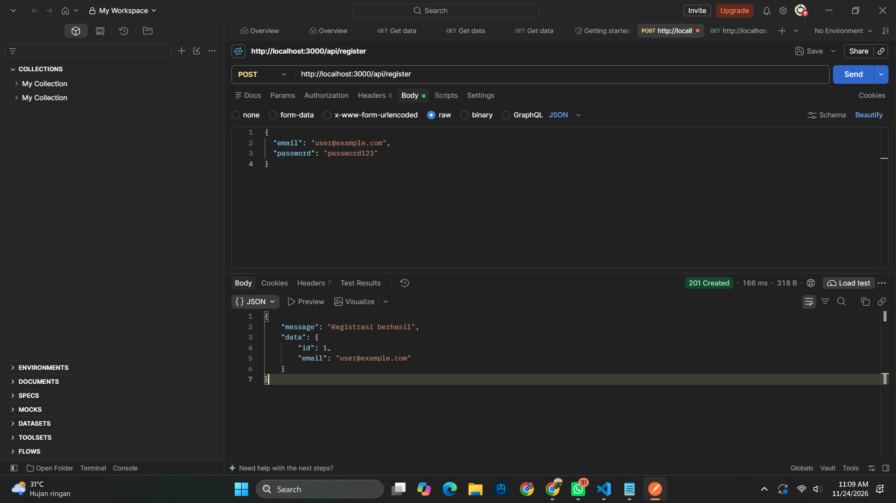
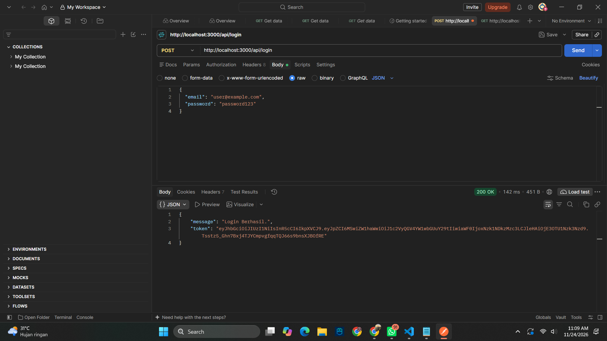
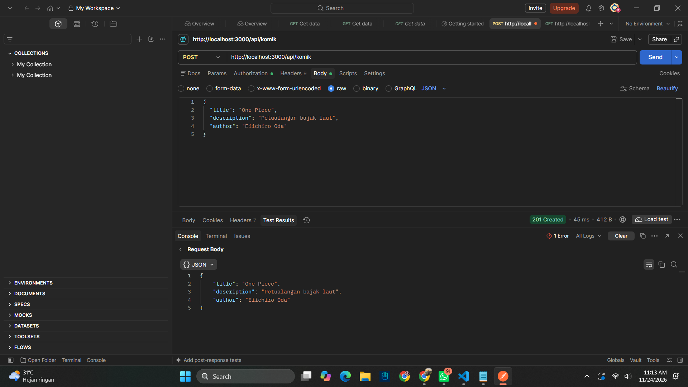
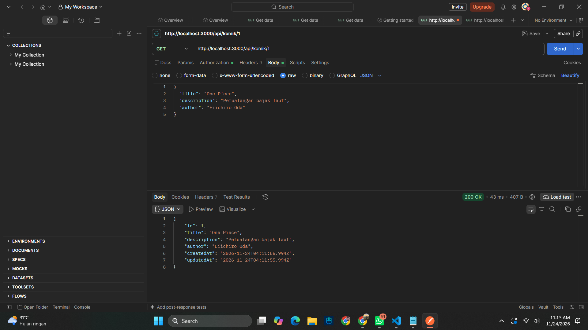
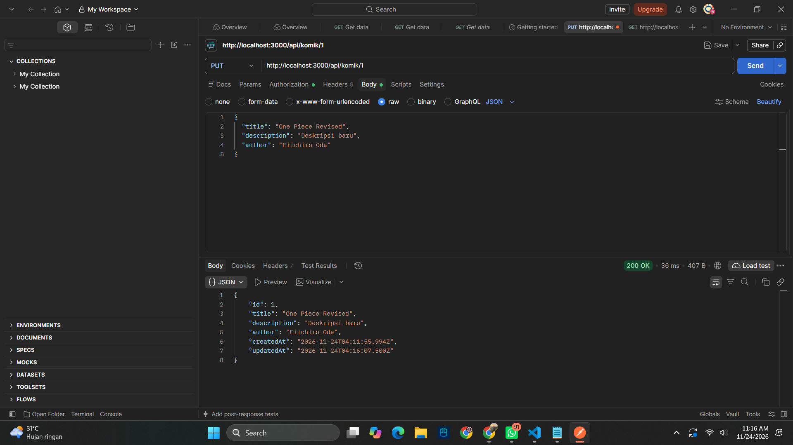
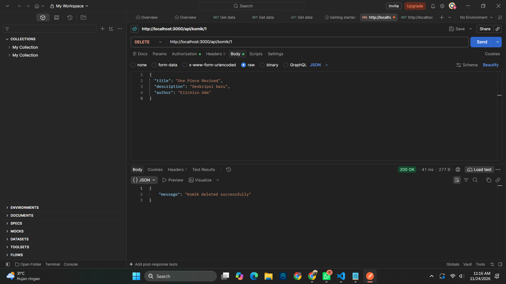

# Dokumentasi API & Testing Postman (JWT Auth & Komik CRUD)

Berikut adalah hasil pengujian endpoint menggunakan Postman:

## 1. Authentication (User)

### Register (`POST /api/register`)

### Login (`POST /api/login`)

---

## 2. Komik CRUD

### Create Komik (`POST /api/komik`)

### Get All Komik (`GET /api/komik`)

### Get Komik By ID (`GET /api/komik/:id`)

### Update Komik (`PUT /api/komik/:id`)

### Delete Komik (`DELETE /api/komik/:id`)

